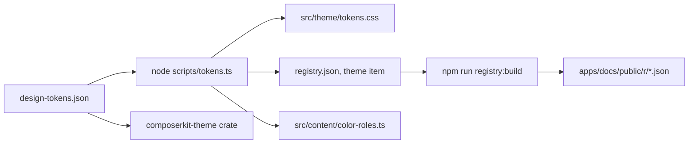

# Contributing to ComposerKit

Thank you for helping with ComposerKit. The guide below explains how to set up the repository, where each part of the code lives, and which checks to run before you open a pull request.

## Set up the repository

You need Node.js 26, which is the version the CI uses, and npm. The Rust crates also need Rust 1.99 or later, but you only need Rust if you change the crates.

```bash
git clone https://github.com/bjoernaagaard/ComposerKit.git
cd ComposerKit
npm ci
```

The repository is an npm workspace, so `npm ci` installs the packages for the library, the docs site and the demo app at once.

## Run the apps

Most changes start in the demo app or the docs site, because both of them load the components straight from `packages/composerkit/src`. A change to a component shows up in both apps when you save the file.

| Command | What it does |
| --- | --- |
| `npm run dev` | Starts the demo app at <http://localhost:5173>. The composer state harness is at `/states/composer`. |
| `npm run docs:dev` | Starts the docs site at <http://localhost:3000>. |
| `npm run build` | Builds the demo app into `apps/playground/dist`. |
| `npm run docs:build` | Builds the docs site as static files into `apps/docs/out`. |
| `npm run build --workspace composerkit` | Builds the npm package into `packages/composerkit/dist`. |

## Where the code lives

The library folder holds more than the components that ship. The files in `components/` and `lib/` go into both the registry and the npm package. The other folders hold the demo app and the sample data that the docs examples use.

```text
packages/composerkit/
├── registry.json          # the shadcn registry items and the files in each one
├── src/
│   ├── components/        # ships in the registry and the npm package
│   │   ├── ui/            # button, icon button, tip, menu
│   │   ├── composer/      # the composer, its reducer and its controller hook
│   │   └── conversation/  # the conversation view and its parts
│   ├── lib/utils.ts       # ships, holds cn
│   ├── theme/tokens.css   # ships in the npm package, generated from the design tokens
│   ├── styles.css         # ships in the npm package only
│   ├── content/           # sample data, ships as the registry's sample-data item
│   ├── states/            # composer states for the docs and the harness, also in sample-data
│   ├── app/               # the demo app shell, which doesn't ship
│   └── designs/           # other looks for the demo app, which don't ship
├── vite.config.ts         # builds the npm package
└── scripts/finish-dist.ts # fixes the type imports and copies the CSS after the build
```

The components import each other with the `@/` alias, such as `@/components/ui/button`. Keep the alias, because the shadcn CLI rewrites it to the alias of the app that installs the item. The npm build turns it into relative paths.

## How the theme files are made

The colors, sizes and motion values live in one file, `crates/composerkit-theme/design-tokens.json`. Don't edit the files made from it by hand. Change the token file instead, and then run the script that writes the other files.

```bash
node scripts/tokens.ts
npm run registry:build
```

The diagram below shows which files each step writes.



The Pages workflow fails when the committed files in `apps/docs/public/r` don't match `registry.json`. Run `npm run registry:build` and commit the result whenever you change a component or `registry.json`.

## Check your change

Run the checks below before you open a pull request. The CI builds the package, the docs site and the demo app. It doesn't run the linter, the type check or the end to end tests, so run them yourself. The end to end run takes a few minutes.

1. Run `npm run check` to lint and check the formatting. Run `npm run fix` to fix most problems.
2. Run `npm run typecheck` to check the types in every workspace.
3. Run `npm pack --workspace composerkit --dry-run` to build the npm package and list the files it would publish.
4. Run `npm run e2e:docs` to build the docs site and check every page with Playwright. The run writes a report to `artifacts/docs-e2e/report.md`.

If you change the Rust crates, also run `cargo clippy --all-targets`. To see every native component, run `cargo run --example catalog --package composerkit-ui`.

## Write the change

Every source file starts with an SPDX header that names the copyright holder and the MIT license. Copy the header from a file next to yours. Files that can't hold a comment, such as JSON and Markdown, get their license from `REUSE.toml`.

```ts
// SPDX-FileCopyrightText: 2026 Bjørn Aagaard
// SPDX-License-Identifier: MIT
```

Pull request titles follow the Conventional Commits format, with the area of the change in parentheses, for example `fix(composer): keep the draft when a send fails`. The behavior in `spec/functional.md` is the reference, so a change that makes a component look or act differently from the spec needs a reason in the pull request.

## Ask a question or report a bug

Open an issue at <https://github.com/bjoernaagaard/ComposerKit/issues>. For a bug, say which component it is, what you did, and what you expected to happen. A link to a page in the docs or the demo app that shows the bug helps the most.
