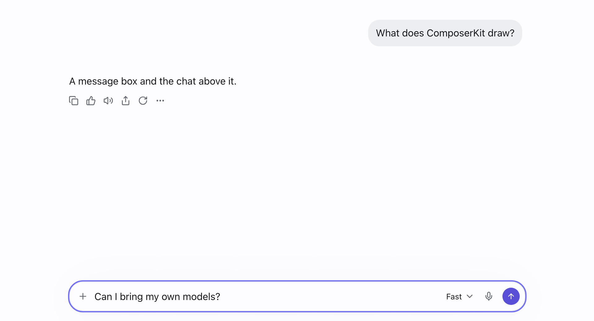
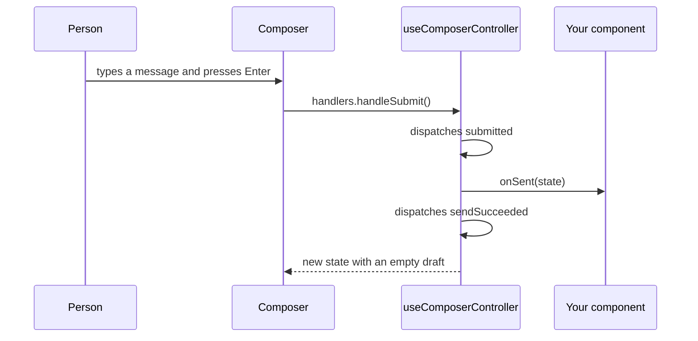

# ComposerKit

ComposerKit is a set of React components for chat apps. It has a message box, called the composer, and a conversation view that shows the chat above the composer. It also has an app shell for the window around them, a chat sidebar that lists the chats, and the buttons, menus and tooltips that the other components use. The components are built on [Base UI](https://base-ui.com) and styled with Tailwind CSS v4.



The docs site has a live example, the API and the keyboard support for each component, at <https://bjoernaagaard.github.io/ComposerKit/>. You can also try the [demo app](https://bjoernaagaard.github.io/ComposerKit/playground/), which puts all of the components together.

## Install

You can add ComposerKit to an app with the shadcn CLI or with npm. The shadcn CLI copies the source files into your app, so you own the code and can change it. The npm package gives you compiled files that you import and update with npm.

|  | shadcn registry | npm package |
| --- | --- | --- |
| What you get | Source files in your `components/` folder | Compiled files in `node_modules/composerkit` |
| Import path | `@/components/composer/composer` | `composerkit/components/composer/composer` |
| How you update | Run `shadcn add` again and merge the changes | Run `npm update composerkit` |
| When to pick it | You want to change the components | You want to use the components as they are |

### Install with the shadcn CLI

Your app needs shadcn with Tailwind CSS v4, which `npx shadcn@latest init` sets up. The fastest start is the chat-app block, which adds a whole chat app as one page at `app/chat/page.tsx`, with the app shell, the chat sidebar, the composer and the conversation. Edit it to use your own chats and replies.

```bash
npx shadcn@latest add https://bjoernaagaard.github.io/ComposerKit/r/chat-app.json
```

You can also add only the items you want. Each item brings the items it needs, so the composer also adds the theme, the button, the menu and the tip.

```bash
npx shadcn@latest add https://bjoernaagaard.github.io/ComposerKit/r/composer.json
npx shadcn@latest add https://bjoernaagaard.github.io/ComposerKit/r/conversation.json
```

### Install from npm

Your app needs React 19 and Tailwind CSS v4. Install the package, and then import its stylesheet after Tailwind in your main CSS file.

```bash
npm install composerkit
```

```css
@import "tailwindcss";
@import "composerkit/styles.css";
```

The stylesheet adds the ComposerKit theme in light and dark, and it tells Tailwind to scan the components for the classes they use. Add the `dark` class to an element, such as `<html>`, to show the dark theme inside it.

The examples in the docs use the shadcn import paths. Each source file is also a module in the npm package, at the same path, so you can change an import by replacing `@/` with `composerkit/`.

```diff
-import { Composer } from "@/components/composer/composer";
+import { Composer } from "composerkit/components/composer/composer";
```

## Quick start

The conversation view is the fastest way to see the components work. You give it the first turns of the chat, the choices for the composer's menus, and a `reply` function. When someone sends a message, the view calls `reply` and shows the answer a few characters at a time.

```tsx
import type { ComposerOptions } from "composerkit/components/composer/options";
import { ConversationView } from "composerkit/components/conversation/conversation-view";
import { toBlocks } from "composerkit/components/conversation/types";
import type { Turn } from "composerkit/components/conversation/types";

const options: ComposerOptions = {
  efforts: [{ id: "normal", label: "Normal" }],
  models: [{ id: "fast", label: "Fast" }],
  permissions: [{ id: "ask", label: "Ask first" }],
};

const turns: Turn[] = [
  {
    attachments: [],
    blocks: toBlocks([
      { kind: "paragraph", text: "What does ComposerKit draw?" },
    ]),
    id: "t1",
    role: "user",
  },
  {
    attachments: [],
    blocks: toBlocks([
      { kind: "paragraph", text: "A message box and the chat above it." },
    ]),
    id: "t2",
    role: "assistant",
  },
];

export const App = () => (
  <div className="bg-background text-foreground h-screen">
    <ConversationView
      options={options}
      projects={[]}
      reply={() => [{ kind: "paragraph", text: "Thanks. Here is a reply." }]}
      title="Help chat"
      turns={turns}
    />
  </div>
);
```

The conversation view fills its container, so give the container a height. The `bg-background` and `text-foreground` classes give the page the theme's colors.

## Components

Each component has its own page in the docs, with examples, the props, the keyboard support and the theme tokens it uses.

| Component | What it is | Module path |
| --- | --- | --- |
| [Theme](https://bjoernaagaard.github.io/ComposerKit/theme/) | The colors, sizes, type and motion, in light and dark | `styles.css`, npm only |
| [Button](https://bjoernaagaard.github.io/ComposerKit/button/) | Text buttons, and icon buttons that show their name in a tip | `components/ui/button`, `components/ui/icon-button` |
| [Tip](https://bjoernaagaard.github.io/ComposerKit/tip/) | A short label that shows on hover and keyboard focus | `components/ui/tip` |
| [Menu](https://bjoernaagaard.github.io/ComposerKit/menu/) | A dropdown menu with items, choices and submenus | `components/ui/menu` |
| [Composer](https://bjoernaagaard.github.io/ComposerKit/composer/) | The message box with attachments, model and access menus, and send. Files dropped on it or pasted into it attach too. | `components/composer/composer` |
| [Conversation](https://bjoernaagaard.github.io/ComposerKit/conversation/) | An open chat with its turns and the composer below | `components/conversation/conversation-view` |
| [App shell](https://bjoernaagaard.github.io/ComposerKit/app-shell/) | The window around an app: a title bar with tabs that people can move, a rail, a sidebar that remembers its state, and the main region | `components/app-shell/app-shell-provider`, `components/app-shell/app-shell` and one module for each other part |
| [Chat sidebar](https://bjoernaagaard.github.io/ComposerKit/chat-sidebar/) | The chat list in the sidebar: New chat, search, pinned chats, projects, recent chats, and archive with undo | `components/chat-sidebar/chat-sidebar` and one module for each other part |

The module paths are the same after `@/` in a shadcn app and after `composerkit/` in the npm package. The registry also has the [chat app](https://bjoernaagaard.github.io/ComposerKit/chat-app/) block, which puts the components together on one page, and a [sample data](https://bjoernaagaard.github.io/ComposerKit/sample-data/) item, which holds the data that the docs examples import. The npm package doesn't include the chat app or the sample data.

## How the composer state works

The composer draws a state that your component owns. The `useComposerController` hook keeps the state in a reducer, and it gives the composer handlers for sending, uploads and dictation. When someone sends a message, the hook calls your `onSent` function with the state that was sent, and then it clears the draft and the attachments.



You can use the composer on its own in the same way.

```tsx
import { Composer } from "composerkit/components/composer/composer";
import { initialComposer } from "composerkit/components/composer/machine";
import type { ComposerOptions } from "composerkit/components/composer/options";
import { useComposerController } from "composerkit/components/composer/use-composer-controller";

const options: ComposerOptions = {
  efforts: [{ id: "normal", label: "Normal" }],
  models: [{ id: "fast", label: "Fast" }],
  permissions: [{ id: "ask", label: "Ask first" }],
};

export const MessageBox = ({ onSend }: { onSend: (text: string) => void }) => {
  const composer = useComposerController(
    (sent) => onSend(sent.draft),
    initialComposer(options)
  );

  return (
    <Composer
      dispatch={composer.dispatch}
      handlers={composer.handlers}
      mode="chat"
      options={options}
      projects={[]}
      state={composer.state}
    />
  );
};
```

The hook doesn't upload files to a server. It moves each file's progress bar on a timer, so you can see the upload states. To upload files for real, write your own `ComposerHandlers` and dispatch the same actions from `components/composer/machine` as your upload runs.

## Repository layout

The repository holds the components, the docs site and the demo app. It also holds a Rust version of the components for apps built with GPUI, the Rust UI framework that the Zed editor uses.

```text
packages/composerkit/   # the components, the registry source and the npm package
apps/
├── docs/               # the docs site (Next.js and Fumadocs), with the built registry in public/r
└── playground/         # the demo app and the composer state harness (Vite)
crates/
├── composerkit-theme/  # the design tokens and a theme for gpui-kit apps
└── composerkit-ui/     # the same components for gpui-kit apps, in Rust
spec/functional.md      # how the reference app looks and behaves, measured by hand
scripts/                # turns the design tokens into CSS variables
e2e/docs/               # Playwright checks for the docs site and the registry
```

## Contributing and releases

[CONTRIBUTING.md](CONTRIBUTING.md) explains how to set up the repository, how the theme files are made, and which checks to run before a pull request. [RELEASING.md](RELEASING.md) explains how to publish a new version to npm, and [CHANGELOG.md](CHANGELOG.md) lists the changes in each version.

## License

ComposerKit uses the MIT license. See [LICENSE](LICENSE).
